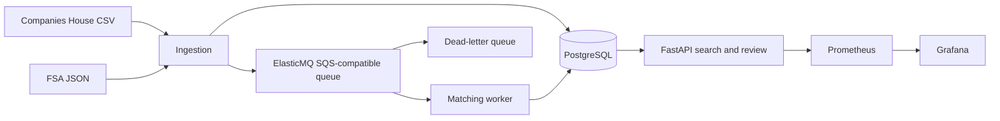

# UK Business Entity Resolution Service

Production-style learning project for SDE I interviews. Links Companies House legal entities with FSA trading premises for a compliance analyst. Candidate links are not official verification or proof of legal ownership.

## Architecture


## Quick start (Windows PowerShell or any shell with Docker Compose)
Install Docker Desktop (personal use), Git and Python 3.12. No AWS account or paid API. From the extracted repository:
```sh
docker compose up --build -d
docker compose ps
docker compose exec api python -m src.ingest data/companies_demo.csv data/fsa_demo.csv
docker compose logs --tail=50 worker
```
Open http://localhost:8000/docs and call GET /business with name ABC and postcode TN9 1AB. Expected synthetic demo result: F1/C1, score 100. Open http://localhost:3001 (default local admin/admin, change when prompted), dashboard Business API. Prometheus: http://localhost:9090. Stop with `docker compose down` (database persists); `docker compose down -v` destroys database volume. Queue is ephemeral in this demo. Never expose these local services to the internet.

## Local development
```powershell
py -3.12 -m venv .venv
.\.venv\Scripts\python.exe -m pip install -r requirements-dev.txt
.\.venv\Scripts\python.exe -m pytest --cov=src --cov-report=term-missing
.\.venv\Scripts\python.exe -m ruff check .
.\.venv\Scripts\python.exe -m mypy src
```
Linux/macOS: use `python3.12 -m venv .venv` and `.venv/bin/python`.

## Real data
Optional Windows smoke test: `powershell -ExecutionPolicy Bypass -File smoke-test.ps1` (inspect the script first). See docs/DATA_GUIDE.md for download, regional conversion, labelling and evaluation. Demo records are fictional. Do not commit raw bulk datasets or credentials. Real data metrics are not yet available.

## Measured results (package creation environment)
| Metric | Result |
|---|---|
| Automated tests | 14 passed (SQLite service tests, matching and converter tests) |
| Overall Python statement coverage | 78% |
| Real records processed | Not measured |
| Precision / recall / F1 | Not measured on real labelled pairs |
| p95 latency | Not measured |
| PostgreSQL / ElasticMQ end-to-end | Not run in package creation environment |
| CI / Ruff / mypy | Not verified in package creation environment |

Targets: 85%+ coverage, 95%+ auto-match precision, p95 <500 ms under a specified test workload. Targets are not results. See docs/RESULTS.md and replace with actual reproducible measurements.

## Design and limits
- SQS-compatible ElasticMQ is a local emulator, not AWS deployment. Boto3 uses local placeholder credentials.
- Candidate index uses postcode district or first normalized name token. Common tokens can produce large candidate sets; measure this. The index is rebuilt each poll for simplicity.
- Score is a weighted heuristic, not a calibrated probability. FSA premises can link to multiple candidate legal entities; ambiguous high scores require further work before real compliance use.
- Idempotency is transactional for repeated identical payloads. This is a batch snapshot prototype; changed records do not automatically invalidate previous links. For new snapshots use a fresh database or implement versioned reconciliation.
- Review endpoints are local-only and unauthenticated; no public deployment. Rate limit is per-process, not distributed. Quarantine covers invalid FSA payloads; invalid company rows abort import. Queue is not durable across container removal.
- Monitoring covers HTTP metrics; worker telemetry can be extended. No real production customers or on-call claims.

See docs/USER_TASKS.md for the tasks that require your participation, docs/ROADMAP.md for daily tickets, RUNBOOK.md for operations and docs/incidents for controlled experiments. This is a generated implementation baseline, not a claim that you personally wrote it or that it is production certified.
