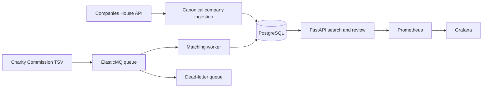

# UK Business Entity Resolution Service

A local backend engineering portfolio project linking Charity Commission register entries to Companies House company records. It retains the original fictional food-premises fixtures for regression testing. Candidate links are suggestions, not official identity verification.

## Architecture



## Quick start

Python 3.12, Git and Docker Compose. Local-only credentials; never expose the services publicly.

```powershell
docker compose up --build -d
docker compose exec api python -m src.ingest data/companies_demo.csv data/fsa_demo.csv
python -m ruff check .
python -m mypy src
python -m pytest --cov=src --cov-report=term-missing --cov-fail-under=85
```

API: http://localhost:8000/docs; Grafana: http://localhost:3001; Prometheus: http://localhost:9090. See RUNBOOK.md. Do not delete database volumes. See docs/DATA_GUIDE.md for real-data workflows and docs/problem.md for scope.

## Verified Phase A/B results

- 24 passing tests and 90.32% statement coverage at Phase B completion; Windows and Linux Python 3.12 CI.
- Synthetic 5,000-company, 20-query workload: 100,000 to 4,000 candidate comparisons (96% reduction), 4,904.782 ms to 127.459 ms, all 20 known candidates retained.
- SQLite cache benchmark: 10 builds to 1 over 10 unchanged polls.
- Synthetic PostgreSQL 50,000-row query: 24.421 ms to 0.087 ms, with changed substring-to-prefix semantics.
- Both expected fictional matches recovered and an unknown business returned no match.

These are single-run measurements under specific synthetic workloads, not production latency or real-world accuracy. See docs/verification and docs/decisions/phase-b-engineering.md. Phase C results are reported separately in docs/RESULTS.md after verification.

## Evaluation and limitations

Official company numbers provide reference labels; the query matcher does not see them. The corpus includes companies fetched using those labels plus same-postcode distractors, so evaluation is conditional on a controlled pool, not independent nationwide search. Incorporated charities may be cleaner than other records. Contact addresses may differ from registered offices, and different company numbers are not proof of unrelated entities. The candidate cap can omit real matches. The tuned evaluation threshold is offline unless separately deployed and tested. Scores are not calibrated probabilities. The legacy `fsa_id` field is retained as a query ID for backwards compatibility.

ElasticMQ is a local SQS-compatible emulator, not AWS. Review endpoints are unauthenticated and local-only; queue durability and snapshot reconciliation remain future work. The 85% coverage gate measures application `src`, not the separate data preparation/evaluation scripts; those scripts have focused tests. No production or cloud deployment claims.

Sources: Charity Commission for England and Wales public register and Companies House Public Data API. See docs/DATA_GUIDE.md for source URLs, attribution and privacy precautions. Raw data, API keys and truth files remain private. This project began from a generated implementation baseline; subsequent testing, benchmarking and engineering decisions are documented in the Git history.
